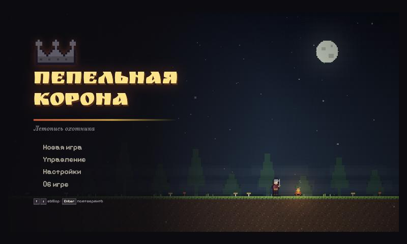
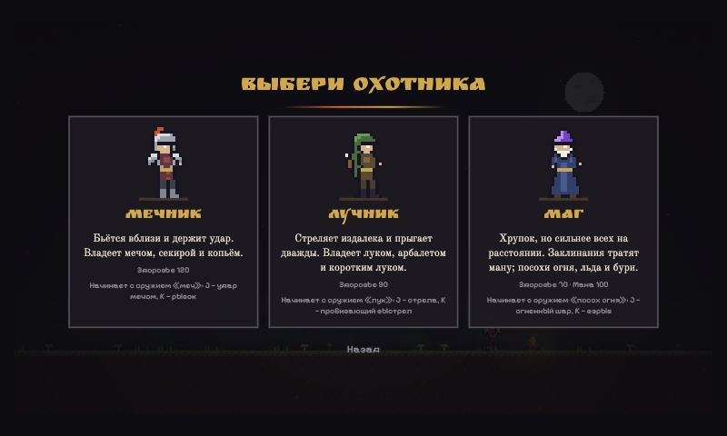
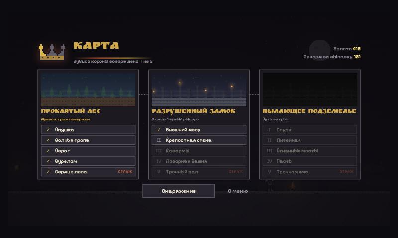
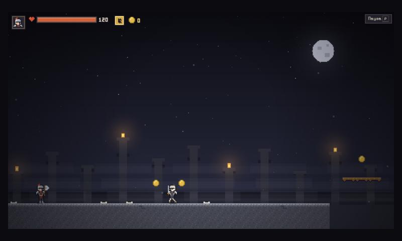
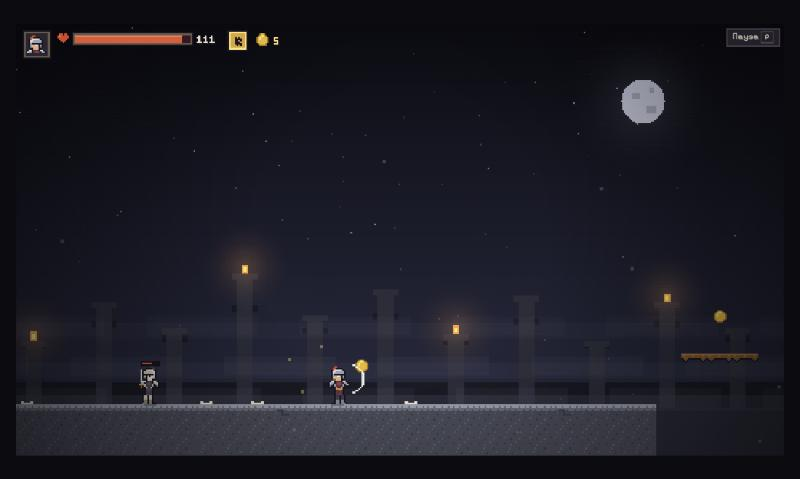
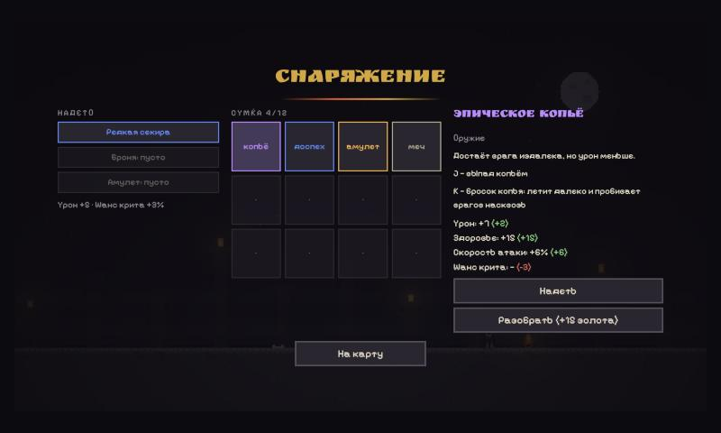

# Пепельная корона

Пиксельный платформер на чистом JavaScript и Canvas. Практическое задание 3 курса «Web-дизайн».

Корона трёх городов сгорела, и земля заболела. Охотник на чудовищ берёт заказ: пройти лес,
замок и подземелье, одолеть трёх стражей и вернуть корону.



| | |
|---|---|
|  |  |
|  |  |



## Что в игре

- **Три мира по пять уровней** — пятнадцать уровней, в пятом уровне каждого мира ждёт страж.
  - *Проклятый лес* — слизни и волки, ямы и шипы. Страж: Древо, бьёт корнями и призывает слизней.
  - *Разрушенный замок* — скелеты-мечники и скелеты-лучники. Страж: Чёрный рыцарь, рывок и прыжок с ударной волной.
  - *Пылающее подземелье* — бесы, лава, огненные столбы. Страж: Демон, залпы огня и столбы пламени.
- **Три класса**: мечник (много здоровья), лучник (двойной прыжок), маг (мана и заклинания).
  Героя можно сменить на карте: уровни, золото и сумка сохраняются.
- **Девять видов оружия** — по три на класс. Вид оружия меняет облик в руке, атаку и способность:

  | Класс | Оружие | Атака (J) | Способность (K) |
  |---|---|---|---|
  | Мечник | меч | быстрый удар | рывок сквозь врагов |
  | | секира | медленный тяжёлый удар | круговой удар |
  | | копьё | дальний выпад | бросок копья насквозь |
  | Лучник | лук | стрела по дуге | пробивающий выстрел |
  | | арбалет | редкий сильный болт | залп из трёх болтов |
  | | короткий лук | частые слабые стрелы | дождь стрел навесом |
  | Маг | посох огня | огненный шар | взрыв вокруг героя |
  | | посох льда | осколок, замораживает | ледяная волна |
  | | посох бури | молния насквозь | цепная молния |

- **Снаряжение** четырёх редкостей в три слота (оружие, броня, амулет): урон, здоровье,
  скорость атаки, шанс критического удара. Падает с врагов (15 %), со стражей — гарантированно.
- **Окно находки**: подобранный предмет останавливает игру и показывает, чем он отличается
  от надетого. Надеть можно сразу — бонусы и новое оружие действуют немедленно.
- **Сумка на 12 предметов**, сравнение с надетым, разбор лишнего в золото.
- **Корона** — знак прогресса: каждый поверженный страж возвращает ей один золотой зубец.
- **Сюжет**: пролог, текст перед каждым уровнем, записки у костров, реплики стражей, эпилог.
- **Костёр** — контрольная точка и один раз за вылазку полностью лечит. Из врагов иногда выпадают сердца.
- **Опасность видна заранее**: метка на полу перед ловушкой, мигание врага перед ударом.
  Волк нападает, только если видит героя, и перед броском замирает.
- **Отпор**: удар отбрасывает и оглушает врага; ранив героя, враг отскакивает.
- **Свет и темнота**: уровни погружены в полумрак, который разгоняют герой, костры, факелы,
  лава, огненные ловушки и заклинания.
- **Окружение**: земля с объёмом (тёмные кромки обрывов, затемнение в глубину), ели, кусты
  и надгробия в лесу, знамёна, колонны и светящиеся окна в замке, сталагмиты, клетки на цепях
  и тлеющие кристаллы в подземелье.
- **Анимации**: оружие проходит дугу при взмахе, копьё выдвигается в выпаде, герой растягивается
  в прыжке и сжимается при приземлении, отшатывается при ранении и падает при гибели;
  поверженные враги отлетают и тают, слизни пульсируют, скелеты заносят меч перед ударом.
- **Логова стражей**: за ареной стоит то, что страж стережёт, — исполинское дерево с тлеющими знаками,
  тронный зал со знамёнами и лунным окном, огненный провал. Страж спит в тени; когда герой
  подходит, мир на миг замирает, экран сужается полосами и звучит его имя.
- **Значки предметов** в сумке и в окне находки, плавное появление окон и карточек.
- **Отклик на действия**: тряска и замирание кадра при ударах, числа урона, пыль, след рывка,
  вспышка при ранении, звуки.
- **Музыка**: спокойная в меню и на карте, бодрая в уровнях — своя у каждого мира. Музыка уровня
  следует за игрой: идёшь один — лёгкий ритм; рядом враги — вступают ударные и мелодия;
  проснулся страж — темп ощущается плотнее, бас и арпеджио уходят выше.
- **Настройки**: громкость звуков и фона, тряска экрана, записки у костров, окно находки.
- **Сохранение** в браузере: прогресс, снаряжение и настройки переживают перезагрузку страницы.

## Управление

| Действие | Клавиши |
|---|---|
| Идти | A / D, ← / → |
| Прыжок (чем дольше держишь, тем выше) | Пробел, W, ↑ |
| Атака (можно удерживать) | J |
| Способность оружия | K |
| Пауза | P, Esc |
| В меню: выбор и подтверждение | ↑ / ↓, Enter; Esc — назад |

Клавиши работают в любой раскладке. Мышь для игры не нужна.

## Запуск

Игра использует ES-модули, поэтому нужен локальный сервер:

```bash
python3 -m http.server 8000
```

Затем открыть http://localhost:8000.

## Тесты

Нужен Node.js 20 или новее. Зависимостей нет.

```bash
node --test
```

## Устройство

Логика отделена от отображения и не обращается к странице — поэтому проверяется в Node.

| Что | Где |
|---|---|
| Игровой цикл (шаг 1/60 с), состояния, правила мира | `js/Game.js` |
| Столкновения прямоугольников и тайлов | `js/Collision.js` |
| Разбор карты уровня | `js/Level.js` |
| Клавиатура | `js/InputHandler.js` |
| Герой, враги, стражи, снаряды, добыча | `js/entities/` |
| Генерация снаряжения, сумка, сохранение, настройки, звук | `js/systems/` |
| Отрисовка поля: фон, мир, эффекты | `js/Renderer.js` |
| Меню и экраны (HTML), надписи поверх игры | `js/ui/` |
| Все числа и содержимое: классы, оружие, враги, предметы, уровни, тексты, спрайты | `js/data/` |

Уровень — это список участков по 20×17 тайлов, записанных символами; мир собирает пять
уровней из своей библиотеки участков (`js/data/levels.js`). Спрайты — массивы строк,
где символ означает цвет пикселя (`js/data/sprites.js`).

## Проверка качества

| Требование задания | Как выполнено |
|---|---|
| Логика по времени кадра | реальное время копится и расходуется шагами по 1/60 с; длинный кадр обрезается до 0,1 с; отрисовка сглаживает движение между шагами |
| Пауза при потере видимости | событие `visibilitychange` ставит игру на паузу |
| Очистка при перезапуске | `InputHandler.detach()` снимает обработчики, `cancelAnimationFrame` останавливает цикл; `setInterval` и `setTimeout` в логике не используются |
| Клавиатура и подсказка | всё управление на клавишах; экран «Управление» в меню и в паузе |
| Звук после действия, громкость | звук включается с первого нажатия; ползунки «Звуки» и «Музыка», ноль выключает |
| Уменьшение движения | при системной настройке «меньше движения» отключаются появления экранов и «печать» текста; тряска экрана отключается в настройках |

### Результаты проверки

- **Автотесты:** 336 тестов, все проходят (`node --test`). Покрыты: столкновения, разбор уровней,
  движение героя, оружие и способности, враги и стражи, добыча, сумка, сохранение, настройки,
  звук, состояния игры.
- **Проходимость уровней:** программа-бот на той же логике, что и игра, прошла все 15 уровней
  каждым из трёх классов (45 прогонов из 45 с отключённым уроном по герою; 41 из 45 — с уроном,
  хотя бот не уклоняется от атак).
- **Проверка данных:** тесты подтверждают, что каждый уровень собирается, участки стыкуются
  по высоте, у каждого спрайта верный размер, у каждого оружия и снаряда есть картинка.
- **В браузере (Chromium):** просмотрены титульный экран, меню, пролог, выбор класса, карта,
  снаряжение, сюжетный экран, бой; консоль без ошибок.

### Поддерживаемые браузеры

Проверено в Chromium. Используются только стандартные возможности (ES-модули, Canvas 2D,
Web Audio, `localStorage`), поэтому игра должна работать в актуальных Chrome, Edge, Firefox
и Safari — но в Firefox и Safari она не запускалась.

### Известные ограничения

- Баланс сложности подобран по прогонам бота и одному отзыву игрока: числа врагов и стражей
  могут потребовать правки.
- Плавность на 60 кадрах в секунду и звук автор проверки оценить не мог — это нужно
  посмотреть и послушать вручную.
- Нет сенсорного управления и поддержки геймпада; на экранах уже 960×540 интерфейс мелкий.
- Шрифты загружаются из сети; без сети игра работает на запасных системных шрифтах.
- Один слот сохранения. Сумка у всех героев общая: оружие другого героя лежит в ней, но надеть его нельзя.

## Ресурсы и лицензии

- Графика (спрайты, фон, эффекты), звуки и музыка созданы кодом проекта; файлов изображений и звука нет.
  Мелодии написаны для игры и записаны нотами в `js/systems/Audio.js`.
- Сторонних библиотек нет.
- Шрифты с Google Fonts, лицензия SIL Open Font License 1.1:
  Ruslan Display (заголовки), Old Standard TT (сюжетный текст), Pixelify Sans (интерфейс).

## Журнал применения AI-помощника

Инструмент: Claude Code (Anthropic).

**Задача.** Спроектировать и реализовать платформер по заданию: от разбора требований
и спецификации до кода, тестов и проверки.

**Существенный запрос.** «Хочу оставить ту же сюжетную логику и механику с выбиванием
ресурсов с противников, но добавить несколько классов по оружию — маг, лучник, мечник».
Позже: «детальнее персонажей, чтобы у оружия менялись облик и умения в зависимости от вида,
и по пять уровней на каждый мир».

**Что было предложено и принято.**
- Чистый JavaScript с ES-модулями и Canvas без сборки — код открывается как есть и объясним целиком.
- Фиксированный шаг логики 1/60 с с накоплением времени — физика не зависит от частоты монитора.
- Герой и враги не знают про игру: удары и выстрелы они складывают в очередь, а `Game` их применяет.
  Так классы проверяются по отдельности.
- Уровни из библиотеки участков: 15 уровней собраны из ~40 участков, а не нарисованы каждый с нуля.

**Что было отклонено или переделано.**
- Phaser.js отклонён: физику и столкновения делала бы библиотека, а задание требует свою логику.
- Шипы сначала ранили по всему тайлу, хотя нарисованы в его нижней половине — прыжок
  «в последний момент» наказывался несправедливо. Зона урона уменьшена до нарисованной.
- Стражи сначала были активны с начала уровня (рыцарь шёл к герою через всю карту) —
  теперь они спят, пока герой не войдёт на арену, и не покидают её.
- Демон зависал прямо над героем, и лучник с магом не могли в него попасть — теперь держится сбоку.
- Восстановление маны мага увеличено с 8 до 14 в секунду: маг убивал стража втрое дольше других.
- Здоровье нигде не восстанавливалось — добавлено лечение у костра.
- После первой пробной игры: волки видели героя сквозь стены и бежали быстрее него, враги почти
  не отлетали от ударов и быстро убивали. Добавлены проверка прямой видимости и пауза перед
  броском, усилено отбрасывание, снижены урон и здоровье врагов, на первом уровне убраны волки.
- Движение было дёрганым: картинка рисовалась в 480×270 и растягивалась, объекты прыгали
  на целые игровые пиксели. Теперь холст создаётся в разрешении экрана, положения сглаживаются
  между шагами логики, герой разгоняется и тормозит плавно.

**Как проверялся результат.**
- Логика покрыта автотестами (336 тестов); они запускаются после каждого изменения.
- Бот проходит каждый уровень каждым классом на настоящей логике игры. Именно он нашёл
  несправедливые шипы, «бегущих» стражей, недосягаемого Демона и выстрел, разбивавшийся
  о стену вплотную к врагу.
- Экраны просмотрены в браузере, консоль проверена на ошибки.

**Собственные исправления.**

<!-- Этот раздел заполняет автор работы: что было изменено вручную после проверки и почему. -->
